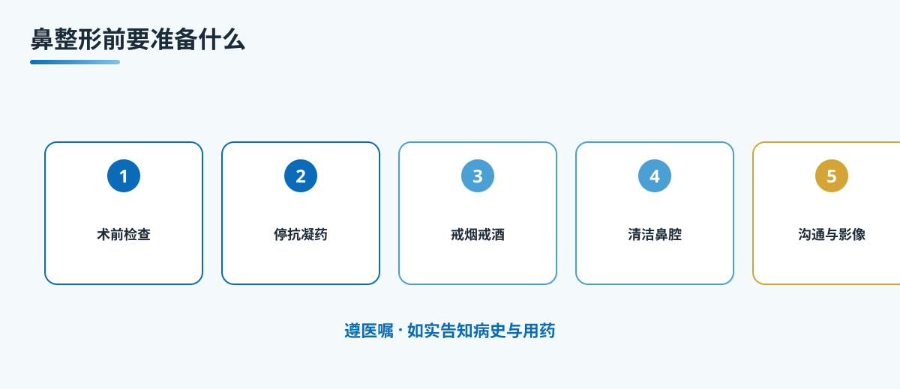

# A10 鼻整形前要准备什么：检查、停药、戒烟

## 三个备选标题
1. 鼻整形前要准备什么：检查、停药、戒烟
2. 手术前一周，这几件事最容易踩坑
3. 想做鼻子，先过几道"安检"

本稿选用第 1 个作为工作标题。

## 封面介绍（100 字以内）
手术本身只占一小段，真正决定安全与恢复的，往往是术前那一段准备。这一篇讲清术前要做哪些检查、哪些药要停、为什么戒烟戒酒，以及把病史和用药如实告诉医生有多重要。

## 正文
先说结论：**鼻整形的安全，很大程度取决于术前准备做得扎不扎实，而不是等上了手术台才见分晓。**

很多人把注意力都放在"医生技术好不好"上，却忽略了手术前一整段的准备。检查、用药、烟酒、鼻腔清洁、预期沟通，每一环掉链子，都可能让恢复变慢，甚至让本该顺利的手术平添波折。

### 术前检查，把底子摸清楚
血常规、凝血功能、传染病筛查、心肺与血气等项目，具体做哪几项由医生结合你的情况决定，并不是人人划一。这些检查的意义在于评估你能否耐受麻醉与手术，有没有出血倾向、有没有影响愈合的全身问题。主动配合、别嫌麻烦，是对自己负责，也是给麻醉医生一份可靠的"底子报告"。

### 停药，更要诚实报药
阿司匹林、华法林这类抗凝抗血小板药，以及一些活血化瘀的中成药或保健品，都可能增加出血风险，医生会根据需要安排你在术前停用。但停药有讲究，特别是长期服用抗凝药的人，不能想停就停，要由医生评估时机，必要时跟原科室协调。这里最关键的环节，是把你在吃的所有药、包括中成药和保健品，都如实告诉医生。别因为"觉得不重要"或"怕被说"就隐瞒，那会直接影响评估。

### 戒烟戒酒，别小看
吸烟会让血管收缩、影响局部血供，增加愈合不良与感染的概率，也会影响麻醉；饮酒会影响凝血与麻醉耐受。一般会建议在术前一段时间就停下来，具体时长以医嘱为准。除了烟酒，鼻部清洁也要提前做好，按医生要求清理鼻腔、避开经期等，这些细节都能减少术中术后的麻烦。

### 心理准备，把预期说透
术前好好跟医生沟通，看面诊照片与影像，讲清你想要什么，也听清哪些做不到。鼻整形的边界由你的基础条件决定，而不是在脑海里画一张完美的图。把"想要"和"可能"对齐，术后才不会觉得落差太大。

## 收尾
术前准备看着琐碎，其实每一条都在为安全和恢复铺路。检查做全，药要报真，烟酒戒掉，预期聊透，这几件事落实到位，比临时抱佛脚有用得多。术前有任何疑问，先问医生，别自己拿主意。

> 本文用于健康教育，不能替代整形外科/耳鼻喉专科查体与麻醉评估。

## 参考资料
- 中华医学会整形外科分会. 鼻整形相关诊疗规范（公开版检索）
- American Society of Plastic Surgeons. Rhinoplasty. https://www.plasticsurgery.org/cosmetic-procedures/rhinoplasty
- 国内整形外科教材（围术期准备、抗凝药管理、术前评估）

## 版本说明
- 大纲依据：《鼻整形系列大纲.md》
- 本稿版本：v1（待医生医学审校、可读性测试）
- 待办：医生署名、专科审校、机构能力边界自检
