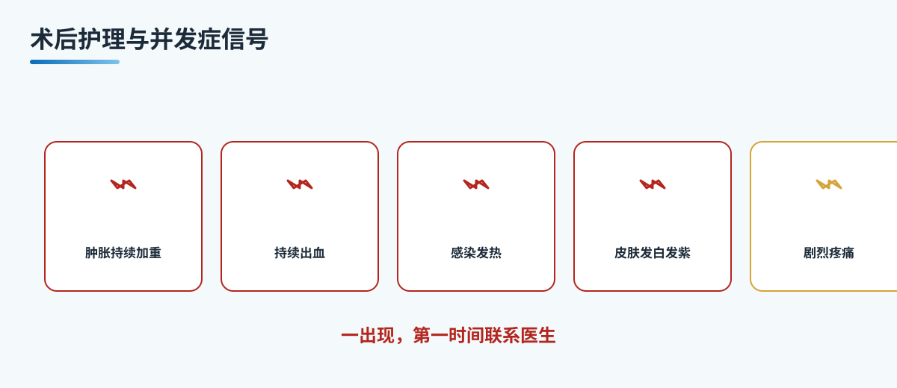

# A12 术后护理与并发症信号：肿胀、出血、感染

## 三个备选标题
1. 术后护理与并发症信号：肿胀、出血、感染
2. 鼻子做完后的这几天，怎么护理才稳
3. 这些信号一出现，别拖，马上复诊

本稿选用第 1 个作为工作标题。

## 封面介绍（100 字以内）
鼻子做完，护理在前，识别信号更重要。这一篇讲清术后要保持清洁、避免碰撞与用力擤鼻、按医嘱换药拆线，也讲清楚哪些肿胀、出血、感染的信号一出现就要立刻复诊。

## 正文
先说结论：**鼻整形的后半程，拼的是护理和及时识别异常，把该做的做到位，把该警惕的信号看住。**

术后护理并不复杂，难的是持续做到位，以及分得清哪些是正常反应、哪些是需要立刻处理的信号。把这层分清楚，恢复期就能走得更稳。

### 每天要做的几件事
保持伤口清洁干燥，按医嘱换药，早期避免沾水。短时间内避免碰撞、避免用力擤鼻和挤压鼻部，让鼻子安静下来。按时拆线，之后按医嘱使用瘢痕产品或注意防晒。这些是基础动作，做得越稳，恢复越顺。饮食上以清淡、易消化为主，保证充足休息，也有利于恢复。拆线与复诊节点按医生安排执行，不要自行判断。

### 正常反应，还是需要警惕
术后轻度肿胀、少量渗血、轻微疼痛，多半是正常过程，会随着恢复慢慢减轻。但下面这些信号要格外留心。
- **肿胀不断加重**。肿胀没有如期消退，反而越来越严重，要留意。
- **持续出血**。少量渗血算正常，若持续出血、量变多，要尽快复诊。
- **感染迹象**。出现发热、脓性分泌物、局部红肿热痛加重，提示可能感染。
- **皮肤发白或发紫**。提示局部血供可能受影响，需要尽快处理。
- **剧烈疼痛**。超出正常度的疼痛，或休息后也不缓解，要及时就诊。

判断的标准有两个方向。一是看趋势，正常反应会随时间和护理逐渐减轻。二是看程度，一旦某个异常明显、持续或加重，就不该再归为"正常"。这两点记住了，就不容易误判。

### 有异常别拖
这些红旗信号不一定就意味着出了问题，但一旦出现，最好的做法是尽快联系医生或复诊，由专科判断，而不是自己再等等看。拖延只会让处理更加被动，反而不利于恢复。

## 收尾
术后护理，就是把日常的清洁、防碰撞、按医嘱换药拆线做好，同时把异常信号记在心里。恢复期的每一步都值得认真对待，有疑问就找医生，把"及时复诊"这四个字落到实处。

> 本文用于健康教育，不能替代整形外科/耳鼻喉专科查体与麻醉评估。

## 参考资料
- 中华医学会整形外科分会. 鼻整形相关诊疗规范（公开版检索）
- American Society of Plastic Surgeons. Rhinoplasty. https://www.plasticsurgery.org/cosmetic-procedures/rhinoplasty
- 国内整形外科教材（鼻整形围术期护理、并发症识别与处理）

## 版本说明
- 大纲依据：《鼻整形系列大纲.md》
- 本稿版本：v1（待医生医学审校、可读性测试）
- 待办：医生署名、专科审校、机构能力边界自检
