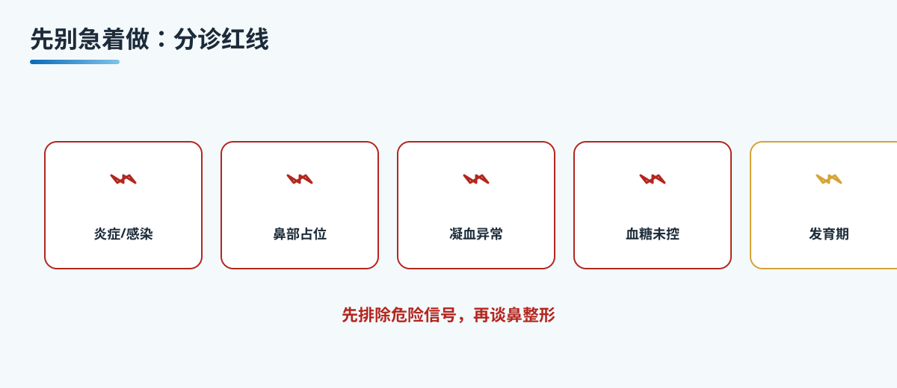

# A5 先别急着做的情况

## 三个备选标题

1. 这几种情况先别急着做：鼻整形的分诊与红线
2. 能做不等于该做，先排除这些红线再谈鼻整形
3. 想垫高鼻梁先停一停，这些情况要先处理

本稿选用第 1 个作为工作标题。

## 封面介绍（100 字以内）

鼻整形有很多人想做，但能做不等于该做。活动性炎症、鼻部占位、凝血异常、血糖未控、发育期、多次修复、妊娠哺乳，以及严重的体象困扰，都要先走分诊。先把该暂缓的排除掉，再谈方案。

## 正文

先说结论：**能做与该做是两回事，做鼻整形前先分诊，把该暂缓或先处理的红线排除掉，再谈形态与功能。**

能做指技术上有这个操作，该做指从你的健康、年龄、鼻部条件与心理状态看，这是否是此刻合适的选择。两者之间隔着一次认真的分诊。它不是卡你，而是把看似可以做、实际不该现在做的情况拦在手术之前。鼻子除了好看，还要通气、要健康，这些都要放在形态前面。

分诊是一套排除在先的检查，由医生结合查体、影像与化验来判断，并不替你决定要不要手术、用哪种方案。它回答的是你的身体现在适不适合、风险大不大。下面这些情况，建议先处理或暂缓安排。

### 先排感染与占位

鼻部有活动性炎症或感染时，不要急着手术。比如正在发作的鼻炎、鼻窦炎、鼻部痤疮或疖肿，还有急性上呼吸道感染。这些会让术中出血与术后感染风险升高，也容易影响愈合。

鼻部摸到、或影像提示有肿瘤、囊肿等占位，更要先查明性质，再谈修复。占位没有搞清楚之前，任何整形方案都是空谈。

### 再看全身状况

凝血功能异常的人，要先明确病因、调整或暂停相关药物，再评估手术出血风险。糖尿病血糖没控制好的人，愈合与感染风险明显增高，建议先把血糖稳住。

免疫力低下，比如正在接受免疫抑制治疗、近期重大疾病或长期营养不良，也要先由专科评估能否耐受手术与麻醉。

### 发育期、修复史与妊娠哺乳

未成年人或还处于发育期的人，鼻骨尚未完全发育。这时候手术可能影响之后的生长与形态，通常建议等鼻部发育基本稳定、达到一定年龄后再评估。

既往做过多次鼻整形、需要再次修复的人，鼻部组织条件已经复杂，血供、瘢痕与软骨都可能受到影响，更需要谨慎评估，而不是急着再来一次。

妊娠期与哺乳期的女性，涉及胎儿与哺乳安全，以及身体状态的改变，建议先暂缓，待生产与哺乳结束后再评估。

### 心理状态也要评估

严重的心理疾病，或者对外貌过度执着、存在明显的体象困扰时，要先接受精神心理评估。鼻整形解决的是组织与形态问题，并不能替代对情绪与自我认知的关注。预期越合理，术后满意度往往越高。

## 收尾

这些情况，都是先别急着做的起点。分诊排除在先，是为了把你的健康放在形态前面。能做的很多，该做的才值得做。到重庆西区医院医学美容中心就诊，请专科医生先做一次完整评估。

> 本文用于健康教育，不能替代整形外科/耳鼻喉专科查体与麻醉评估。

## 参考资料

- 中华医学会整形外科分会. 鼻整形相关诊疗规范（公开版检索）
- American Society of Plastic Surgeons. Rhinoplasty. https://www.plasticsurgery.org/cosmetic-procedures/rhinoplasty

## 版本说明

- 大纲依据：《鼻整形系列大纲.md》
- 本稿版本：v1（待医生医学审校、可读性测试）
- 待办：医生署名、专科审校、机构能力边界自检
